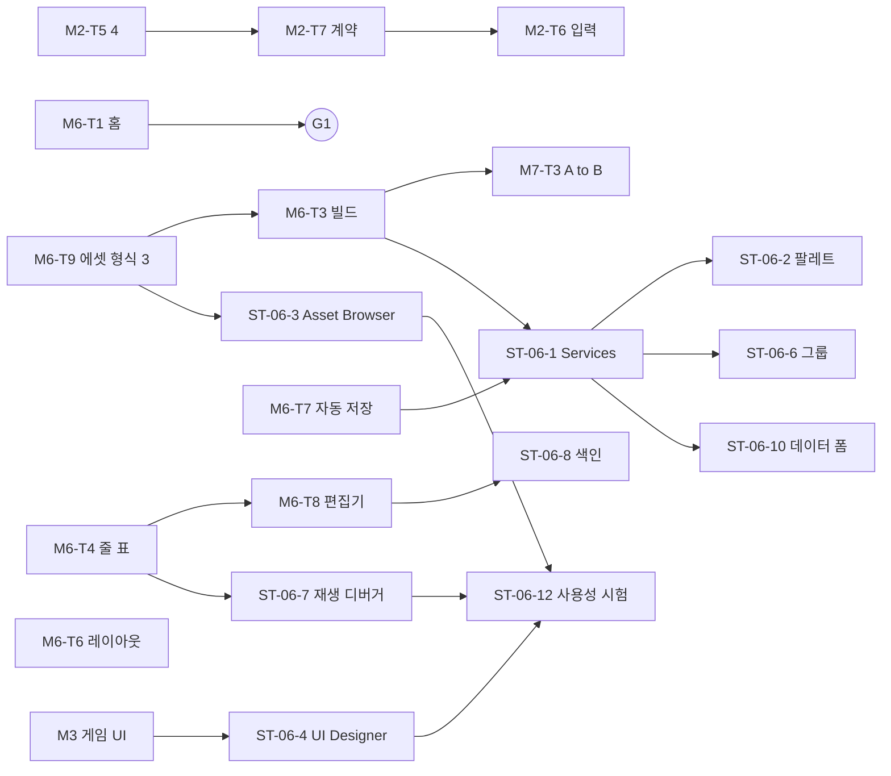

# 23. 통합 로드맵 v0.5 ~ v1.0 — 태스크 카드 · 우선순위 · 의존 그래프 · 출시 기준

> **계획 문서** (2026-11-02, master c651339 — v0.5 M8 뒤). 버전 목표 · 마일스톤 요약은 [18-PLATFORM](18-PLATFORM.md) 1 · 6장, v0.5 의
> 상세는 [20-CREATOR-ALPHA](20-CREATOR-ALPHA.md) 10장 (그대로 — 이 문서가 대신하지 않는다), 실행 구조 설계는 [22](22-RUNTIME-V2.md),
> 보안 · 안정성 출시 기준은 [24](24-SECURITY-GATES.md), 배치 결정은 [ADR-0082](adr/0082-v06-v10-feature-placement.md) ·
> [ADR-0088](adr/0088-v06-v10-placement-update-runtime-v2.md). 초안 [platform/roadmap](platform/roadmap/) 의 요구는 줄이지 않는다 —
> 이 문서는 그 위에 Runtime v2 를 얹고 작업 단위로 나눈다. 모든 줄은 **[계획]** 이다 (✅ 표시가 있는 것만 끝난 일).
> **2026-11-03 Studio 감사로 갱신** ([ADR-0092](adr/0092-three-tracks-creator-studio-placement.md)): 세 트랙 (A Engine Runtime · B Creator Studio ·
> C Platform Services — 0.1장), v0.5 M6 에 Studio 기본 흐름 태스크 (1.1장), v0.6 트랙 B (2.1장). 근거 [audit/](audit/SANDBOX-GAP-MATRIX.md).

> **2026-11-03 로드맵 재구성 ([ADR-0096](adr/0096-roadmap-versioning-small-milestones.md)):** 이 문서의 버전 표기 ("[계획 v0.x]" · "v0.5 M6" …) 는 옛 줄이다 —
> 목표 버전 · 상태의 정본은 [roadmap/task-registry](roadmap/task-registry.md), 읽는 법은 [versioning 4장](roadmap/versioning.md). 태스크 ID 는 그대로.
> **로드맵의 정본은 [roadmap/](roadmap/README.md) 이다** — 이 문서는 태스크 카드의 상세 (모듈 · API · 시험) 와 2026-11-03 까지의 이력으로 남는다.
> 0장 "지금 · 다음" 은 [roadmap/README](roadmap/README.md) 1장, 6 ~ 8장 (GA · DAG · 미룰 순서) 은 roadmap 의 release-gates 4장 · README 4장.

---

## 0. 한 줄 · 다음 태스크

```text
지금      v0.7 게임 UI Runtime · 다국어 ✅ 0.7.0 (2026-11-09 — releases/v0.7.0). v0.6 ✅ 0.6.0 · v0.5 ✅ 0.5.0 (아래 줄은 roadmap/README 1장과 같다)
다음      트랙 A  M6-T4 ✅ (v0.9) — v0.9 의 남은 일은 트랙 B (NG-05 ✅ → M6-T8 ✅ · ST-06-7 ✅ · ST-06-8 ✅ — v0.9 태스크 끝, 창 확인 뒤 0.9.0), 트랙 A 는 v0.10 — RT-06-1 ✅ → RT-06-10 · RT-06-7 · RT-06-8 — v0.7 의 M3 · M4 · NG-06 ✅
트랙 B    ST-06-1 Editor Services ✅ · M6-T1 (홈) ✅ · M6-T3 (Build) ✅ · M6-T7 (자동 저장) ✅ · M6-T6 (레이아웃) ✅ · ST-06-9 (테스트 세션) ✅ · M5-T1 (--replay) ✅ · M5-T2 (탐색) ✅ · Studio UI UI-0 ~ UI-3 ✅ (29) · M5-T3 (기록) ✅ · NG-07 (시험 층) ✅ · NG-03 (Player) ✅ · ST-06-2 (팔레트 · 테마) ✅ → UI-4 창 QA → 0.8.0 (v0.8 — ST-06-11 은 v0.12, ADR-0123) — v0.6 의 NG-12 · NG-13 · M6-T9 · NG-01 ✅
그다음   
          M3 → M4 · M5 → M6 → M7 (20 10장 진행 차례에 M2-T7 하나를 끼움 — 이유는 1장)
```

우선순위:

```text
P0  그 버전의 출시 차단 또는 호환 계약 (나중에 바꾸면 기존 게임 · 형식이 깨진다)
P1  그 버전 목표의 핵심 기능 (빠지면 버전 목표를 못 이룬다)
P2  가치가 크지만 다음 버전으로 미룰 수 있다 (미룰 순서의 앞)
P3  측정 · 수요 근거가 생기면 (검토 항목 — 근거 없이 만들지 않는다)
```

### 0.1 세 트랙 (ADR-0092)

```text
A Engine Runtime   ECS · VM · 물리 · 네트워크 · 렌더 · 저장 · 결정론 · 성능 — 22, RT-* 태스크, M2 · M8
B Creator Studio    Studio Shell · 장면 · 에셋 · 스크립트 IDE · UI 디자이너 · 시각 스크립팅 · 제작자 디버깅 — 25 ~ 28, M3 · M4 · M5 · M6, ST-* 태스크
C Platform Services Hub · 계정 · 배포 · 마켓 · 호스팅 · 운영 · 보안 — 21 · 초안 roadmap, v0.6 ~ v0.9
병렬                트랙끼리 병렬. 맞닿는 계약 (명령 · 형식 번호 · 패키지 · Host 표) 을 바꾸는 태스크만 순서를 맞춘다 (7장)
단계 이름            v0.5 = 트랙 B "기본 흐름 (Technical Alpha)", v0.6 = 트랙 B "Closed Creator Alpha" — 버전 이름 · 목표는 그대로
```

태스크 카드의 14 칸: ① ID · 제목 ② 우선순위 ③ 버전 · 마일스톤 ④ 목적 ⑤ 선행 ⑥ 변경 모듈 ⑦ API · 인터페이스 (타입 · Capability · 단계 ·
예산 · 수명) ⑧ 형식 · 번호 영향 (.sbc · Host 지문 · 프로토콜 · kSimVersion · 세이브) ⑨ 결정론 ⑩ 보안 (24 의 #) ⑪ 시험 ⑫ 벤치 · 측정
⑬ 문서 ⑭ 완료 기준 · 병렬 가능.
v0.6 이후의 표는 칸을 줄여 적는다 — ④ 목적 · ⑬ 문서는 22 의 해당 장, ⑫ 벤치는 "완료" 칸, 빈 칸은 해당 없음. 그 버전에 들어갈 때
1장 형식의 카드로 펼친다 (v0.5 가 20 10장에서 한 것처럼).

---

## 1. v0.5 Creator Alpha — 남은 일 (목표 그대로: "A 가 만든 게임을 B 가 다른 환경에서 실행")

M3 ~ M7 의 카드는 20 10장의 표 (내용 · 모듈 · 인터페이스 · 선행 · 시험 · 완료) 가 이미 같은 칸을 갖고 있어 다시 적지 않는다. 우선순위만:
M3-T1 ~ T5 · M6-T2 · M7-T1 ~ T5 = P0 (완료 기준 C1 ~ C4 · X1), M4-T1 ~ T4 · M5-T1 · T2 · M6-T1 · T3 · T4 = P1, M3-T6 · T7 · M5-T3 ·
M6-T5 = P2 (미룰 순서는 ADR-0078 6).

M2-T5 를 네 조각으로 나눈다 ((1) 은 ✅). 조각마다 커밋 하나 · 전체 CTest.

```text
① M2-T5 (2) onEvent "action" ✅ (2026-11-02 — 19 18장)                    ② P0   ③ v0.5 M2
④ 오목의 "돌 놓기" 를 스크립트가 판정 (20 3.5) — PlayerAction 효과 뒤 스크립트 규칙
⑤ M2-T5 (1) ✅
⑥ core/simulation (17d 이벤트 수집 — 받아들여진 행동), core/script (SystemEvents 표에 action), script/api (GameEvent 필드), script/sdk
⑦ GameEvent { kind: "action", action: string, player: i32, pos: Vec2, targets: Entity[] } — server onEvent, Capability = 기존 onEvent 그대로,
   틱마다 시스템별 eventsPerTick (ADR-0063) 안, 수명 = 그 호출
⑧ Host 지문 변경 (이벤트 종류 · 필드 — kHostApiVersion 1 그대로), .sbc 그대로, 프로토콜 그대로, kSimVersion: 구독이 없으면 그대로 (시험으로 확인)
⑨ 순서 = (틱, 행동 명령 차례 — issuer · sequence), 리플레이는 명령으로 재현
⑩ N1 의 일부 — 서버가 받아들인 행동만 (거절된 명령은 이벤트 없음)
⑪ test_script_callbacks 확장 (행동 → 이벤트 순서 · 필드 · 거절된 행동 없음 · 두 월드 해시), det_* 골든 그대로
⑫ 없음 (이벤트 수집 비용은 구독 시에만)
⑬ 19 18장 (이벤트 표), 20 3.5 (✅ 표시), 03 2장 17d 설명, 13, DEVELOPMENT_LOG
⑭ 오목형 시험 팩이 스크립트로 수를 판정 — 병렬: M2-T7 과 파일이 겹친다 (script/api) → 순서대로

① M2-T5 (3) PlayerSignal · signals.json · 프로토콜 15 · onEvent "signal" ✅ (2026-11-02 — 11 6.1장, rate → perTick)  ② P0
④ UI 버튼 · ctx.send 가 서버 규칙을 부르는 유일한 길 (20 3.7) — M3-T5 · M2-T6 의 선행
⑤ M2-T5 (2)
⑥ core/command (PlayerSignal), core/content (signals.json · 새 V 규칙 · contentHash), network/protocol (15), core/simulation, core/script,
   apps/client (보내기 경로만 — UI 없이 시험 명령)
⑦ SimCommand PlayerSignal { name (팩 이름공간), value: i32 } · GameEvent { kind: "signal", name, player, value } · signals.json
   { "<이름>": { min, max, rate } } (rate 기본 10/s)
⑧ 프로토콜 14 → 15, 콘텐츠 형식 (signals.json — 11 갱신), 리플레이 명령 종류 추가 (kReplayVersion 그대로 — 명령 직렬화는 확장 가능한지
   첫 단계에서 확인, 안 되면 올린다), kSimVersion 그대로 (신호가 없으면 같은 해시)
⑨ 명령 = 리플레이 기록, 이벤트 순서 = (틱, issuer, sequence)
⑩ N1 — 선언 없는 이름 · 범위 밖 · rate 초과 · 역할 (observer) 거절, 변형 퍼즈에 PlayerSignal
⑪ unit_network (프로토콜 15 · 왕복), unit_content (V 규칙), test_script_callbacks (signal), net_convergence 에 신호, 퍼즈
⑫ 없음
⑬ 08 (프로토콜 15), 11 (signals.json), 09 4장 (명령 종류), 19 18장, 20 3.7, 13, 17
⑭ 로컬 세션에서 시험 명령 → 서버 이벤트 → 스크립트 판정, 위조 거절 시험 통과 — 병렬 불가 (network · content · command 를 넓게 건드림)

① M2-T5 (4) 플레이어 · 세션 · owner 적기 ✅ — (4a) 플레이어 표 (ADR-0093), (4b) "owner": true · ctx.setOwner (ADR-0094 — kSimVersion 그대로)  ② P1
④ 스크립트가 플레이어 · 세션을 알고 행동 · 신호 · spawn 이 game.owner 를 적는다 (20 3.4 · 3.6) — "@owned" 바인딩 (M3-T4) 의 바탕
⑤ M2-T5 (3)
⑥ core/game (플레이어 표 — 리플레이에 기록된 것만), core/script/ScriptHost, script/api, script/sdk
⑦ ctx.players(): PlayerInfo[] { id, name, role, team } (id 순) · ctx.session { state, tick, winner, teams } (읽기 — EcsRead),
   spawn(…, { owner }) · 행동 · 신호가 owner 적기
⑧ Host 지문 변경, kSimVersion: owner 적기가 기존 골든 (행동이 있는 시나리오) 을 바꾸면 5 로 (측정 — AGENTS 5장)
⑨ 플레이어 표 변경 = 명령 스트림 (재생 때 같은 값) — 20 3.4 의 "확인 필요" 를 이 조각에서 닫는다
⑩ client 는 읽기 (복제된 것만)
⑪ test_script_players (id 순 · 접속 · 나감 · 재생 같은 값), 골든 측정
⑫ 없음
⑬ 19 16장, 20 3.4 · 3.6, 04 (kSimVersion 이력 — 바뀌면), 13
⑭ 오목 판정이 "누구의 돌" 을 owner 로 안다

① M2-T7 Runtime v2 계약 동결 ✅ (2026-11-03 — script/api/Callbacks · capability 열 · network.model, 19 26장)  ② P0   ③ v0.5 M2
④ v0.6 ~ v0.8 의 콜백 · Capability · 예측 모델을 나중에 넣어도 v0.5 게임 · SDK 의 뜻이 바뀌지 않게 이름 · 자리를 지금 고정 (ADR-0086 6)
⑤ M2-T5 (4) (Host 표를 같은 파일에서 고친다)
⑥ script/api/HostApi (HostFunction.capability 열), script/lang/Checker (콜백 이름 예약 · 콜백 → 허락 Capability 표), core/project
   (매니페스트 network.model — "snapshot" 만 받음), script/sdk (d.ts 주석 · 예약 콜백은 내보내지 않음)
⑦ 예약 콜백 이름: onPrePhysics · onAction · onLateUpdate · onRender · client onStart · onStop · onEvent · client onTick — 쓰면 S4xx
   "[계획 vX]" 오류 (지금 이름을 다른 뜻으로 쓰는 게임이 생기지 않게). Capability 열 값은 22 3.2 의 이름
⑧ Host 지문 변경 (열 추가 — kHostApiVersion 1), .sbc 그대로, 매니페스트 키 추가 (18 5.2 — 없으면 "snapshot")
⑨ 없음 (실행 경로 그대로)
⑩ V3 계약 (24)
⑪ test_checker (예약 이름 · 지문 고정), unit_project (network.model 값 거절), 기존 스크립트 시험 전부 그대로
⑫ script.regen · script.stdlib 회귀 < 2 % (14 7.13 · 7.15 와 비교 — Capability 열은 실행에 닿지 않아야 한다)
⑬ 19 26장 (새 — 예약 콜백 · Capability), 18 5.2 (network.model), 22 3장 상태, 13
⑭ 예약 · 열 · 매니페스트 시험 통과, 기존 샘플 그대로 — M2-T6 이 Capability 를 단 새 함수로 태어난다 (그래서 M2-T6 앞)

① M2-T6 client 입력 · send · 소리 이벤트 · 오디오 결정 (D-14) ✅ (2026-11-03 — 평평한 이름 keyDown · … · send · playSound, ADR-0095)  ② P0   ③ v0.5 M2
④ client 스크립트가 입력을 읽고 신호를 보낸다 (20 3.8) — 템플릿 · 데모의 조작
⑤ M2-T5 (3) (PlayerSignal), M2-T7 (Capability)
⑥ core/script (ClientScriptHost — 입력 스냅숏 · send 버퍼), apps/client (프레임 입력 → 행동 이벤트 큐), platform/audio (결정에 따라)
⑦ ctx.input.down · pressed · released · axis · pointer (InputRead) · ctx.send(signal, value?) (ClientSend — 틱마다 상한) ·
   ctx.sound.play(id) (Sound) — client onUpdate, 같은 프레임의 행동 이벤트를 잃지 않는다 (큐), 수명 = 그 프레임
⑧ Host 지문 변경, 프로토콜 그대로 (PlayerSignal 재사용)
⑨ 시뮬레이션 밖 (client) — 서버에 닿는 것은 PlayerSignal 명령뿐
⑩ N1 (send 속도 — 서버도 rate 로 다시 거른다)
⑪ test_client_scripts 확장 (입력 → send → 서버 이벤트 — 로컬 세션), 소리 이벤트 수 (Null 백엔드)
⑫ 없음
⑬ 07 5 · 7장, 19 21장, 20 3.8 · 7.4 (D-14 결정), 13
⑭ client 스크립트가 클릭을 신호로 보내고 서버 스크립트가 판정 — 병렬: M3-T1 (ui/ 새 타깃) 과 파일이 겹치지 않아 동시에 가능
```

M2-T7 을 끼운 이유: M2-T6 이 client 함수를 더하는데, Capability 열이 그 뒤에 오면 같은 함수를 두 번 고친다. 둘 다 Host 지문을 바꾸므로
같은 버전 안에서 한 번 더 바뀌는 것뿐 — 호환 영향 없음 (kHostApiVersion 1).

v0.5 출시 기준 = 20 13.1 · 13.2 + 24 2장의 v0.5 줄 + 28 1장 (G1 ~ G4 · G6 · G8 · G9).

### 1.1 트랙 B — v0.5 Studio 기본 흐름 (Studio 감사 2026-11-03 — ADR-0089 ~ 0092)

기존 M6-T1 (홈) · T3 ("패키지" 패널 — 검사 · 시험 · 빌드) 는 그대로 두고 범위만 적는다. 새 태스크는 T6 ~ T9 (번호는 20 10장 Phase 6 표와 같다).

```text
① M6-T1 Studio 홈 · 새 프로젝트 · 열기 · 최근 (기존 — P1 → P0)          ② P0   ③ v0.5 M6 (트랙 B)
④ G1 — CLI 없이 시작 (core::createProject 재사용 — 로직은 있다)
⑤ — (M6-T2 템플릿이 나오면 고르기에 더함)
⑥ apps/client/studio (홈 화면), editor/services/ProjectService [새], 사용자 폴더 studio.json (최근)
⑦ ProjectService::create(dir, id, template) · open · recent — UI 없음 (헤드리스 시험)
⑧ 형식 영향 없음 (프로젝트 매니페스트 그대로)   ⑨ 없음   ⑩ 경로 = 사용자가 고른 폴더만 · 빈 폴더 확인 (createProject 규칙 그대로)
⑪ CTest studio_new_project (28 3장)   ⑫ 없음   ⑬ 25 5장 · 10 · 15   ⑭ G1 통과 — 병렬: T6 · T8 과 가능 (파일 겹침 없음)

① M6-T3 "패키지" 패널 — 검사 · 시험 · 빌드 (기존) + 누락 에셋 검사 · Build 화면 (확장)   ② P0   ③ v0.5 M6
④ G8 — core::buildPackage 재사용, 에셋 참조 닫힘의 누락을 빌드 전에
⑤ M6-T9 (에셋을 패키지에 — 형식 3)   ⑥ editor/services/BuildService [새], editor/ui (Build 화면)
⑦ BuildService::build(project, out) → { 경로, 경고 · 오류[] } — Worker Job, 결과는 메인 큐
⑧ 없음 (형식은 T9)   ⑨ 없음   ⑩ 출력 경로 확인 · 덮어쓰기 확인   ⑪ CTest studio_build (빈 캐시에서 열기)
⑫ 빌드 시간 (14 7.14 패키지 명령 시간과 비교)   ⑬ 25 5장 ⑩ · 15 7장   ⑭ G8 통과

① M6-T6 레이아웃 저장 · Studio 설정 분리 (새)                              ② P1   ③ v0.5 M6
④ 벤치마크 A2 (Godot 레이아웃) · GM-08 (ImGuiLayer.cpp:198 의 낡은 [계획])
⑤ —   ⑥ apps/client/ui/ImGuiLayer (IniFilename → 사용자 폴더 studio/layouts/), apps/client/UserSettings (studio.json)
⑦ 레이아웃 이름 셋 (장면 · 스크립트 · 테스트) · 저장 · 복원 · 기본으로   ⑧ 사용자 설정 파일 하나 더 (안전 모드는 건너뛴다 — M1-T3)
⑨ 없음   ⑩ 깨진 ini = 옆으로 옮기고 기본 (M1-T3 규칙)   ⑪ unit (경로 · 깨진 파일 · 안전 모드)   ⑫ 없음
⑬ 25 4장 · 15 (설정 폴더)   ⑭ 다시 열면 같은 배치 — 병렬 가능

① M6-T7 자동 저장 · 크래시 복구 (새)                                         ② P0   ③ v0.5 M6
④ GM-10 · R6 — 충돌 · 강제 종료 때 작업 손실 방지 (Roblox 5 분 자동 저장 — 벤치마크 F1)
⑤ M1-T1 (충돌 보고 — 비정상 종료 표시)   ⑥ editor/services/AutosaveService [새], 세이브 (core/persist 재사용 — 형식 그대로)
⑦ 주기 (기본 3 분) · 플레이 시작 전 · 저장 안 한 문서 텍스트 → 사용자 폴더 recovery/<프로젝트 해시>/, 다음 시작 때 복구 제안
⑧ 세이브 형식 그대로 (09)   ⑨ 세이브 → 로드가 같은 WorldHash (기존 규칙)   ⑩ 복구본은 사용자 폴더만 · 프로젝트를 덮어쓰지 않는다 · 크기 상한
⑪ CTest studio_recovery (강제 종료 → 복구 → 같은 해시)   ⑫ 50k 개체 월드 한 번 저장 시간 (14 에 기록 — 측정 뒤)
⑬ 25 7장 · 09   ⑭ 복구 성공 — 병렬 가능

① M6-T8 스크립트 편집기 — 자동 완성 · hover · 오류 밑줄 · 저장 위치 구분 (새)  ② P0   ③ v0.5 M6
④ G4 · GM-12 · GM-13 · GM-29 (편집이 오버레이에만)
⑤ 프로토타입 script/lang/LanguageService ✅ (이번 감사), M6-T4 (줄 표 — 오류 줄로 이동)
⑥ script/lang/LanguageService (타입 기반 · 컴포넌트 · import 이름), editor/ui (편집기 위젯), editor/services/DocumentService [새]
⑦ completeAt 확장 · hover(symbol) · [적용 (오버레이)] / [저장 (팩 파일 — 원자적)]   ⑧ 없음 (컴파일러 · 형식 그대로)
⑨ 없음   ⑩ 저장 = 프로젝트 content/ 안만   ⑪ unit (후보 표 · hover · 저장 왕복 — 저장 → 다시 열기 = 같은 내용)
⑫ 자동 완성 응답 시간 (파일 1k · 5k 줄 — 측정해 14 에)   ⑬ 27 · 10 8장   ⑭ G4 통과 — 병렬: T1 · T6 과 가능

① M6-T9 프로젝트 에셋 · .meta 안정 id · 가져오기 (PNG) · .sbpkg 형식 3 · 에셋 루트 차례 (새)  ② P0   ③ v0.5 M6
④ R1 · R2 · GM-03 · GM-04 — **v0.5 C1 (A → B) 차단 해소**
⑤ —   ⑥ core/asset [새 — AssetDatabase], core/package (형식 3 · assets 항목), apps/client (루트 차례), editor/ui (가져오기 최소)
⑦ AssetDatabase::scan(project) · importFile(src) → id · resolve(id | 경로) → 경로   ⑧ .sbpkg 2 → 3 (1 · 2 도 읽는다 — 09 · 18 4장),
   프로젝트 폴더 assets/ (매니페스트 키 없음 — 폴더 규칙)   ⑨ 없음 (에셋은 표시 전용 — ADR-0090 6)
⑩ 24 P7 (크기 · 디코드 상한 · 경로 · 압축 폭탄)   ⑪ unit (가져오기 · 옮기기 → 참조 그대로 · 패키지 왕복 · digest), M7-T3 E2E
⑫ 1k 에셋 훑기 시간 (측정 뒤)   ⑬ 26 · 09 9장 · 06 7.2   ⑭ 자기 PNG 를 쓴 게임이 빈 캐시 다른 폴더에서 보인다 — 병렬 불가 (패키지 형식)
```

---

## 2. v0.6 Sandbox Hub (목표 그대로: "공개 → 기여 PR → 릴리스 → 설치")

Hub 항목 (계정 · 레지스트리 · 불변 릴리스 · GitHub 연동 · 검색 · 목록 · 프로필 · 신고 · 차단 · 분석 · UI 시각 편집 · 경로 API) 은 초안
v0_6 · 21 4장 · 18 6장 그대로 — 저장소 경계 D-06 이 먼저 (P0). 아래는 Runtime v2 의 v0.6 몫 (ADR-0088 2).

| ID | 제목 | P | 선행 | 변경 모듈 | API · Capability · 단계 · 예산 | 번호 영향 | 결정론 | 보안 | 시험 | 완료 |
|----|------|---|------|-----------|-------------------------------|-----------|--------|------|------|------|
| RT-06-1 | 호출 토큰 · Capability 실행 검사 | P0 | M2-T7 | core/script/ScriptHost, script/vm | beginCall 이 단계 기록 · Host 호출마다 비교 | 없음 | 없음 | V3 | 변조 .sbc 로 단계 밖 호출 → HostError | 회귀 < 2 % |
| RT-06-2 | server onPrePhysics (단계 8b) | P1 | RT-06-1 | core/simulation (SystemScheduler · 8b), core/script, script/lang | ServerPrePhysicsContext (EcsRead · PhysicsCommand · Random · Time · Log), 같은 틱 예산 | Host 지문 · 03 단계표 | 스크립트 없으면 단계 없음 → 골든 그대로 | V3 | 단계 순서 · 구조 변경 거절 · 해시 | 8b 콜백이 Movement 앞에서 돈다 |
| RT-06-3 | PhysicsCommand (applyForce · applyImpulse · teleport · setVelocity) | P1 | RT-06-2 | core/systems/Movement, core/script | 호출 끝 커밋 → 단계 9 적용 (saveId, 넣은 차례), 틱마다 상한 1,024 | Host 지문 | 명령 없으면 같다 | V2 | 적용 순서 · NaN · 상한 · 해시 | — |
| RT-06-4 | collider layer · mask 거르기 · trigger 표시 | P1 | — | core/systems/Collision, core/components (collider.trigger) | 필드는 이미 있음 (layer · mask) | 기본 mask 전부 → 골든 그대로, 바뀌면 kSimVersion 5 | 쌍 순서 saveId | — | 거르기 · 골든 | — |
| RT-06-5 | 충돌 · 트리거 Enter · Exit 이벤트 (단계 16a) | P1 | RT-06-4 | core/systems/Collision (쌍 집합), core/simulation, core/script | onEvent collisionEnter · Exit · triggerEnter · Exit, 쌍 (작은 saveId, 큰), 구독 시에만 | Host 지문 | 쌍 정렬 | Q1 | 순서 · 세이브 → 로드 뒤 Exit 정합 | — |
| RT-06-6 | ShapeCast (원 쓸기) | P2 | — | core/script/ScriptHost | ctx.shapeCast(x0,y0,x1,y1,r) → Entity \| null, 길이 ≤ 256 | Host 지문 | (t, saveId) | V2 | raycast 시험과 같은 표 | — |
| RT-06-7 | client 수명주기 onStart · onStop · onEvent · onLateUpdate | P1 | RT-06-1 | core/script/ClientScriptSystems, apps/client | ClientContext, 복제 이벤트 큐 (프레임마다 상한) | Host 지문 | 시뮬레이션 밖 | C2 · Q1 | 순서 · 세션 끝 | — |
| RT-06-8 | onAction · 입력 Context (메뉴 > UI > 게임) · 소비 | P1 | M2-T6 · M3-T3 | platform/common/ActionMap, apps/client | ClientActionContext { action }, Context 스택 | Host 지문 | 밖 | N1 | 우선순위 · 소비 · UI 막기 | — |
| RT-06-9 | onRender · Draw API | P1 | RT-06-7 | render 경계 (RenderFrameInput 에 DrawCommandBuffer), apps/client | ClientRenderContext (Draw 만 — 선 · 원 · 사각형 · 글자), 프레임 1,024 명령 | Host 지문 | 밖 | C1 | ECS · GPU 접근 거절 · 상한 | — |
| RT-06-10 | 타이머 · defineState | P1 | RT-06-1 | core/script (script.timer 엔진 컴포넌트 · 세션 개체), core/simulation (17d) | ctx.after · every · cancelTimer → onEvent "timer" (dueTick, 시스템, 차례), ctx.state | 세이브 (컴포넌트 추가) · Host 지문 | 해시 · 세이브 포함 | D2 | 세이브 → 로드 · 해시 | — |
| RT-06-11 | AccessSet 선언 · Debug 검사 · 단계 프로파일 | P2 | — | core/simulation (System 메타), ServerStats | 시스템마다 읽기 · 쓰기 집합 | 프로토콜 (ServerStats — 바뀌면 번호) | 없음 | — | 선언 밖 접근 단언 | v0.9 병렬의 근거 데이터 |
| RT-06-12 | 비동기 에셋 로드 · 캐시 | P2 | — | render/assets, foundation/job | 요청 → 핸들 (대체 에셋 먼저) | 없음 | 밖 | — | 로드 순서 무관 표시 | 로드 시간 (14) |
| RT-06-13 | 게임패드 · Hold · Double Tap · Combo | P2 | RT-06-8 | platform/* | 트리거 종류 | 없음 | 밖 | — | 트리거 판정 | — |
| RT-06-14 | 2D 애니메이션 클립 · 상태 기계 (표시) | P2 | RT-06-7 | apps/client presentation | 클립 · 상태 · client 이벤트 | 콘텐츠 형식 (11) | 밖 | — | 상태 전이 | — |
| RT-06-15 | 오디오 믹서 · 2D 위치 | P2 | M2-T6 | platform/audio | 버스 · 볼륨 | 없음 | 밖 | — | — | — |

v0.6 출시 기준: 초안 v0_6 완료 기준 + 24 2장 v0.6 줄 (V3 · C1 · Q1 · D2 · P3).

---

### 2.1 트랙 B — v0.6 Closed Creator Alpha (Studio 감사 — ADR-0089 ~ 0092)

| ID | 제목 | P | 선행 | 변경 모듈 | 완료 · 시험 |
|----|------|---|------|-----------|-------------|
| ST-06-1 | Editor Services 층 정리 — Command · Selection · Undo 통합 (월드 + 문서) · check_includes 규칙 | P0 | M6-T3 · T7 · T8 | editor/services, tools/check_includes.py | 규칙 시험 · Undo 왕복 unit |
| ST-06-2 | 명령 팔레트 · 단축키 표 · 테마 | P2 | ST-06-1 | editor/services · ui | 충돌 진단 unit |
| ST-06-3 | Asset Browser 완성 — 썸네일 · 참조 찾기 · 옮기기 · 안전 지우기 · 캐시 · 다시 가져오기 · Hot Reload | P1 | M6-T9 | core/asset, render/asset (다시 업로드), editor/ui | unit · 렌더 시험 |
| ST-06-4 | Game UI Designer (v0.5 문서 그대로 편집) | P1 | M3 · ST-06-1 | editor/ui (designer), ui/ (배치 미리보기) | 문서 왕복 unit · 수동 QA |
| ST-06-5 | Prefab 인스턴스 오버라이드 · 변형 (설계 ADR 먼저 — 결정론 측정) | P1 | — | core/content · core/command · editor/ui | det 시험 (전파 순서 · 해시) |
| ST-06-6 | 편집기 그룹 (worlds/<w>/editor.json) · Hierarchy 검색 · 접기 | P2 | ST-06-1 | editor/services · ui | unit · 10k 개체 측정 |
| ST-06-7 | 재생 디버거 (중단점 · 단계 · 스택 · 지역 · 감시 · logpoint) | P1 | M6-T4 | script/vm (훅), tools (디버그 재생), editor/ui | 재생 중단 · 같은 해시, 훅 비용 < 2 % |
| ST-06-8 | 언어 서비스 색인 — 정의 · 참조 · 이름 바꾸기 · 빠른 수정 · 스니펫 · 증분 분석 | P2 | M6-T8 | script/lang | unit · 응답 측정 |
| ST-06-9 | TestService — 서버 + N 클라이언트 단추 · 지연 · 손실 모의 (SimulatedTransport 노출) | P1 | — | editor/services, network (옵션), platform/process | CTest (서버 + 2 헤드리스) |
| ST-06-10 | 데이터 폼 (콘텐츠 JSON 일반 — FieldMeta) · 트리거 그래프 캔버스 | P2 | ST-06-1 | editor/ui | 스키마 → 폼 왕복 unit |
| ST-06-11 | Scene/Game 뷰 분리 · 떼어 낸 창 (다중 모니터) — v0.12 (ADR-0123: 게임 카메라 정의 먼저) | P3 | ST-06-1 | apps/client · platform · render | 수동 QA |
| ST-06-12 | 제작자 사용성 시험 (28 2장) — 결과를 ALPHA-READINESS 에 | P0 | v0.5 끝 | docs · qa | 시험 기록 |

v0.6 출시 기준 (트랙 B): 28 G5 (시각 UI) · G6 (멀티) · G7 (디버거) 통과 + 사용성 시험 합격 (28 2장).

## 3. v0.7 Multiplayer Platform (목표 그대로: "인증된 방 · 자체 서버 · 무료 세션")

보안 전송 (D-07) · Directory · Room · JoinTicket · 자체 서버 등록 · 무료 세션 · 플레이어 데이터 · 친구 · 초대 · 파티 · 원격 관전 · 방 안 신고 ·
음소거 · 공식 세션 결과 기록은 초안 · 21 4장 그대로 (P0 = 보안 전송 · JoinTicket). **등급전 · 레이팅 · 순위표는 v0.8 로** (ADR-0088).

| ID | 제목 | P | 선행 | 변경 모듈 | API · 단계 · 예산 | 번호 영향 | 결정론 | 보안 | 시험 | 완료 |
|----|------|---|------|-----------|--------------------|-----------|--------|------|------|------|
| RT-07-1 | network.model "predicted" · net.predicted 표시 | P0 | M2-T7 | core/project, core/components | 매니페스트 값 · 엔진 컴포넌트 | 매니페스트 · 카탈로그 | 표시만 | — | 값 · 거절 | — |
| RT-07-2 | Client 고정 Tick 스케줄러 · client onTick | P1 | RT-07-1 · RT-06-7 | apps/client (누산기), core/script | ClientTickContext (InputRead · ClientSend · PredictedWrite), 프레임마다 0 ~ 5 번 | Host 지문 | 횟수 = 시간 / 틱 (FPS 무관) | C2 | FPS 30 · 60 · 144 에서 같은 횟수 | — |
| RT-07-3 | InputFrame · 겹쳐 보내기 · ack | P0 | RT-07-2 | network/protocol (16), network/server (tick 창), core/command | InputFrame { tick, bits, axes } × 3 | 프로토콜 16 · 리플레이 (명령) | executeTick 적용 · 기록 | N3 | 잃음 · 순서 뒤바뀜 · 위조 tick | — |
| RT-07-4 | PredictedWorld · 맞춤 (다시 돌리기) | P1 | RT-07-3 | apps/client (presentation), core/systems (같은 코드 재사용) | 상한 = 지연 / 틱 + 2 | 없음 | 권위 아님 — 같은 입력 = 같은 예측 시험 | N4 | 지연 50 · 150 · 300 ms 시뮬레이션 | 오차 계측 |
| RT-07-5 | 예측 계측 · 네트워크 처리량 프로파일 | P1 | RT-07-4 | ServerStats · client 패널 | 다시 돈 틱 · 오차 · 바이트 | 프로토콜 (ServerStats) | — | — | 수치 범위 | 14 에 기록 |
| RT-07-6 | client onPrePhysics · onPostPhysics (예측 물리) | P2 | RT-07-4 · RT-06-3 | core/script | ClientTickContext 안 | Host 지문 | 권위 아님 | — | 같은 입력 = 같은 결과 | — |
| RT-07-7 | 시간 동기 (클라이언트 tick 앞서기 · ±1 % 조정) | P1 | RT-07-3 | apps/client | — | — | — | — | 지터 시뮬레이션 | — |

v0.7 출시 기준: 초안 v0_7 + 24 v0.7 줄 (N2 · N3 · N4 — 보안 전송 없이 인터넷 방 없음).

트랙 B (v0.7 Multiplayer Creator): 스크립트 초안 · 커밋 (Roblox Drafts 와 같은 사용 모양 — 벤치마크 F1) · 파일 문서 동시 편집 (잠금 또는 3-way —
결정 D-17) · sbx lsp (27 5장) · 포맷터 · 클라이언트 라이브 디버그 · UI 애니메이션 · UI 템플릿 import. 번호는 그 버전에 들어갈 때 ST-07-* 로.

---

## 4. v0.8 Marketplace & Hosting (목표 그대로: "결제 · 정산 · 상시 서버" — 테스트 모드)

Entitlement · 결제 대행 · 정산 장부 · 상시 호스팅 (D-09) · 업적 · 통계 API · 플레이 분석 (동의) · 추천 · 리플레이 공유 + **등급전 · 레이팅 ·
순위표 · 시즌** (v0.7 에서 옮김). Runtime v2 몫:

| ID | 제목 | P | 선행 | 보안 · 결정론 | 완료 |
|----|------|---|------|---------------|------|
| RT-08-1 | NetworkModule (서버만 — fetch · WebSocket · egress 허락 목록 · 할당 · DNS 고정 · TLS) — 새 스레드 하나 (ADR-0086 1) | P1 | 호스팅 (D-09) · RT-06-10 (요청 상태를 컴포넌트에) | X1 ~ X5 전부 (차단), 응답 = 명령 · 리플레이 | 가짜 서버 · 가짜 DNS 시험, 리플레이 해시 |
| RT-08-2 | Substep (게임마다 1 ~ 4) | P2 | RT-06-3 | 기본 1 = 골든 그대로 | — |
| RT-08-3 | CCD (빠른 원 쓸기) · 재질 (마찰 · 반발) | P2 | RT-08-2 · RT-06-6 | 켠 게임만 | — |
| RT-08-4 | 에셋 스트리밍 · 메모리 예산 · 메모리 프로파일 | P1 | RT-06-12 | — | 호스팅 서버 · 클라이언트 메모리 상한 |
| RT-08-5 | Render 스레드 분리 검토 | P3 | 측정 (CPU 렌더 > 6 ms — 01 5.1) | 01 T2 그대로 | 측정이 없으면 하지 않는다 |
| RT-08-6 | Worker 스케줄 · 렌더 CPU 프로파일 | P2 | RT-06-11 | — | 14 에 기록 |

v0.8 출시 기준: 초안 v0_8 + 24 v0.8 줄 (X1 ~ X5 · O3 · O4 · D2).

---

## 5. v0.9 Business & Stability (목표 그대로: "팀 리뷰 → 자동 빌드 → 승인 → 배포")

팀 ACL · CI/CD · 승인 · 감사 (D-10) · 서명 자동 업데이트 · 되돌리기 · 운영 콘솔 · 도구 다국어 그대로. Runtime v2 몫:

| ID | 제목 | P | 조건 (측정) | 결정론 | 완료 |
|----|------|---|-------------|--------|------|
| RT-09-1 | 성능 회귀 CI (기준선 대비 %) | P1 | — | — | PR 마다 sbx_bench 핵심 시나리오 |
| RT-09-2 | 권장 사양 자동 분석 (1080p · Medium · 평균 ≥ 60 FPS · 1 % Low ≥ 50) | P1 | 기준 기기 등급 정의 | — | 매니페스트 recommended 에 측정값 · 기기 · 날짜 |
| RT-09-3 | ECS 단계 안 병렬 (Read 만 겹침 · 셀 커널 · saveId 합치기) | P3 | 단계 하나가 틱의 30 % 초과 (RT-06-11 데이터) | Worker 0 · 1 · N 같은 해시 (W1) | 측정 개선 + 해시 시험 |
| RT-09-4 | 스크립트 Worker (순수 함수 — 쓰기 · Host 없음) | P3 | 스크립트가 틱의 큰 몫 (ADR-0081 5) | 제출 차례 결과 | — |
| RT-09-5 | 잠 (sleep) | P3 | 정지 개체가 많은 시나리오 측정 | 깨어남 규칙 결정적 · 같은 해시 | — |

v0.9 출시 기준: 초안 v0_9 + 24 v0.9 줄 (W1 · O2 · 성능 회귀 CI).

---

## 6. v1.0 Sandbox Platform GA

호환성 표 · 마이그레이션 가이드 · 보안 감사 · 데모 3종 · 접근성 점검 · 게임플레이 API 동결 그대로 + **콜백 · Capability · Context 동결**
(22 3장의 표가 v1.0 계약이 된다 — 그 뒤 바꾸기는 kHostApiVersion 을 올리는 일), 플랫폼 매트릭스 판정 (Windows DX12 · Vulkan, Linux
Vulkan, macOS Metal — **실제로 돈 환경만 "지원"**, CI 만 돈 것은 "CI 확인", 안 돈 것은 "검증 안 됨").

v1.x 검토: 3D · 외부 물리 (Jolt 결정론 빌드 측정), JIT/AOT (ADR-0081), 원격 개체 외삽, 클라이언트 NetworkModule.

---

## 7. 의존 그래프 (DAG) · 병렬 가능

```text
v0.5   M2-T5(2) → M2-T5(3) → M2-T5(4) → M2-T7 → M2-T6 ─┬→ M3-T4 · T5 → M6-T2 → M7
                                         M3-T1 → T2 → T3 ┘ (M3-T1 ~ T3 은 M2-T5 와 병렬 가능 — ui/ 새 타깃, 파일 겹침 없음)
       M4-T1 ∥ M5-T1 (M1 뒤 — 언제든), M6-T4 (.sbc 형식 10 — M8 뒤)
v0.6   D-06 (Hub 경계) → Hub 항목들
       M2-T7 → RT-06-1 → { RT-06-2 → RT-06-3 , RT-06-7 → RT-06-9 , RT-06-10 }
       RT-06-4 → RT-06-5      (RT-06-4 는 RT-06-1 과 병렬 — 물리 코드만)
       M2-T6 · M3-T3 → RT-06-8 → RT-06-13 ;  RT-06-11 · RT-06-12 · RT-06-6 독립
v0.7   D-07 (보안 전송) → 방 · 티켓 …
       RT-07-1 → RT-07-2 → RT-07-3 → { RT-07-4 → RT-07-5 , RT-07-7 } ; RT-07-6 (RT-06-3 뒤)
v0.8   D-09 (호스팅) + RT-06-10 → RT-08-1 ;  RT-06-3 → RT-08-2 → RT-08-3 ;  RT-06-12 → RT-08-4 ; 측정 → RT-08-5
v0.9   RT-06-11 측정 → RT-09-3 ;  RT-09-1 → RT-09-2 ;  RT-09-4 · RT-09-5 (측정 조건)
트랙 B v0.5   M6-T1 ∥ M6-T6 ∥ M6-T8 ∥ M6-T7 (서로 병렬 — editor/services 의 다른 파일),  M6-T9 → M6-T3 (빌드가 에셋 형식을 쓴다) → M7-T3,
              M6-T4 (줄 표) → M6-T8 의 "오류 줄로 이동"
트랙 B v0.6   ST-06-1 → { ST-06-2 · ST-06-6 · ST-06-10 · ST-06-11 } ;  M6-T9 → ST-06-3 ;  M3 → ST-06-4 ;  M6-T4 → ST-06-7 ;  M6-T8 → ST-06-8 ;
              ST-06-5 · ST-06-9 독립 ;  끝 → ST-06-12
형식 번호 순서  .sbc 10 = v0.6 NG-04 (onMigrate), 11 = M6-T4 (줄 표). .sbpkg 3 = M6-T9. 둘은 서로 다른 형식이라 병렬 가능
순차가 꼭 필요한 것  Host 표 (script/api/HostApi.cpp) 를 고치는 태스크끼리 — 지문 고정 시험이 한 번에 하나를 기대한다.
                    프로토콜 번호를 올리는 태스크끼리 (15 → 16 …)
```

### 7.1 트랙 B 의존 (Mermaid)



## 8. 미룰 순서 (버전 목표가 위험할 때 — 위부터 미룬다)

```text
v0.5   ADR-0078 6 그대로 (M8 은 끝) → M2-T7 은 미루지 않는다 (P0 — 호환 계약)
       트랙 B: M6-T6 → M6-T8 의 hover · 밑줄 (자동 완성 · 저장 구분은 남긴다) 순으로 민다. M6-T1 · T3 · T7 · T9 는 밀지 않는다 (G1 · G8 · 데이터 손실 · C1)
v0.6 B ST-06-11 → ST-06-2 → ST-06-10 → ST-06-6 → ST-06-8 (P2 · P3 부터 v0.7 로)
v0.6   RT-06-15 → RT-06-14 → RT-06-13 → RT-06-12 → RT-06-6 → RT-06-11  (P2 부터. Hub P0 은 미루지 않는다)
v0.7   RT-07-6 → RT-07-5 의 패널 (계측 데이터는 남긴다)
v0.8   RT-08-5 → RT-08-3 → RT-08-2 → 등급전 시즌
```
