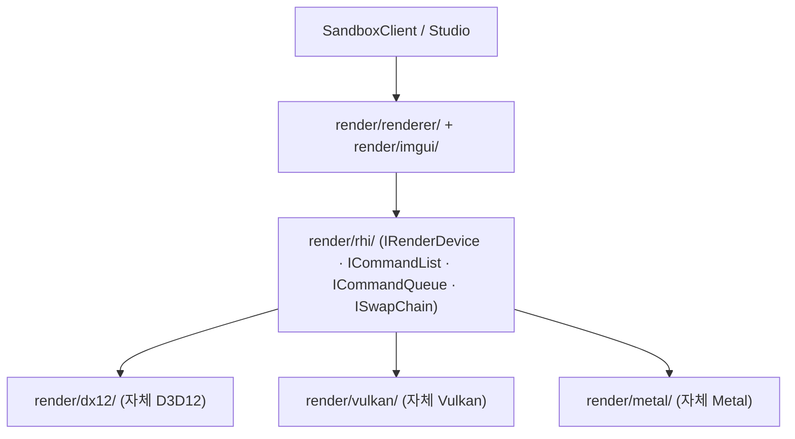
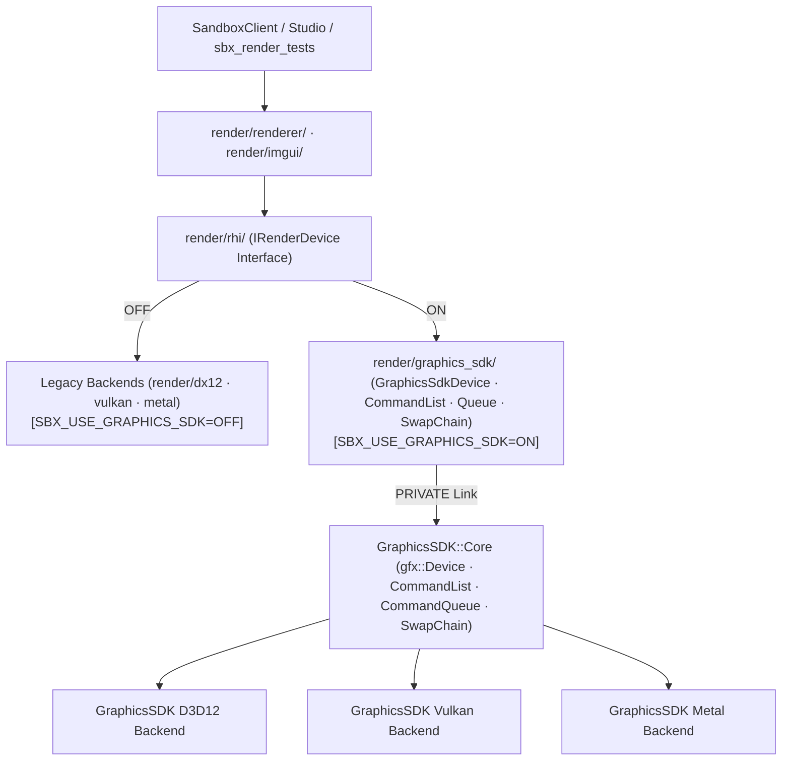
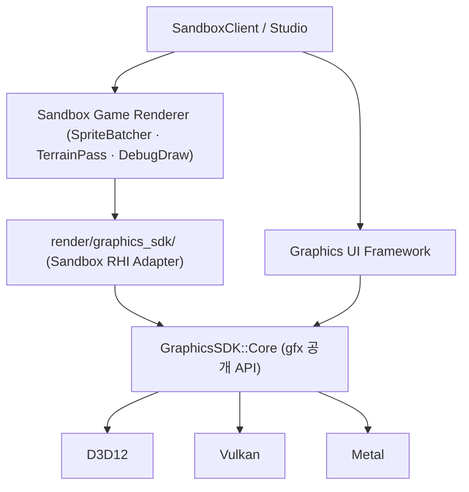

# Graphics SDK 기반 RHI 아키텍처 설계서

본 문서는 Sandbox의 자체 그래픽 백엔드(`render/dx12/`, `render/vulkan/`, `render/metal/`)를 독립적인 **Graphics SDK**(`GraphicsSDK::Core`, 네임스페이스 `gfx`) 기반으로 전환하기 위한 아키텍처 설계를 정의합니다.

---

## 1. 아키텍처 전환 단계

### 1.1 현재 구조 (Legacy)



### 1.2 전환 과정의 공존 구조 (Phase 1 ~ Phase 7)

`SBX_USE_GRAPHICS_SDK` CMake 옵션(기본값 `OFF`)을 통해 기존 Legacy 백엔드와 Graphics SDK 어댑터(`render/graphics_sdk/`)가 완벽하게 공존합니다.



### 1.3 최종 목표 구조 (Phase 8 ~ Phase 10)



---

## 2. 모듈 경계 및 의존성 규칙

[../01-ARCHITECTURE.md](../01-ARCHITECTURE.md) 및 `AGENTS.md` 4장의 경계 규칙을 엄격히 준수합니다.

1. **`GraphicsSDK::Core`는 `SandboxRender` 내부(`PRIVATE`)에만 링크**:
   - `<graphics/Graphics.hpp>` 헤더는 `render/graphics_sdk/` 내부에서만 include 합니다.
   - `foundation/`, `script/`, `ui/`, `core/`, `network/`, `editor/services/`, `SandboxServer`는 `GraphicsSDK`의 존재를 전혀 모릅니다.
2. **네이티브 그래픽/OS 헤더 차단 (`tools/check_includes.py`)**:
   - `render/graphics_sdk/`는 `RESTRICTED` 경로에 `set()`(허용된 네이티브 헤더 없음)으로 등록되어 `d3d12.h`, `dxgi.h`, `vulkan.h`, `Metal.h`, `windows.h`, `X11/*`, `imgui.h`를 일절 include 하지 않습니다.
3. **`SandboxServer` 무의존 보장**:
   - `SandboxServer`는 `SandboxRender`를 링크하지 않으므로 `SBX_USE_GRAPHICS_SDK=ON`일 때도 GUI/그래픽 라이브러리에 의존하지 않습니다 (`arch_link_boundary_selftest` 통과).

---

## 3. 어댑터(`render/graphics_sdk/`) 내부 구성

```text
render/graphics_sdk/
├── GraphicsSdkTypes.hpp / .cpp         # BackendType, Format, ResourceState, LoadOp/StoreOp, NativeSurface, Error 매핑
├── GraphicsSdkResource.hpp             # GraphicsSdkBuffer (cpuShadow 포함), GraphicsSdkTexture, Sampler, Shader,Garbage
├── GraphicsSdkPipeline.hpp / .cpp      # BindGroupLayout/Pipeline 검증 및 (group, binding) → flat SDK binding 매핑
├── GraphicsSdkCommandQueue.hpp / .cpp  # ICommandQueue 구현, 타임라인 Fence 대기 및 Readback 동기화
├── GraphicsSdkSwapChain.hpp / .cpp     # ISwapChain 구현, 외부 백버퍼 핸들 등록/회수, Resize/VSync
├── GraphicsSdkDevice.hpp / .cpp        # IRenderDevice 구현, HandlePool, DeferredDestructionQueue, 슬롯별 UploadRing
├── GraphicsSdkCommandList.hpp / .cpp   # ICommandList 구현, Stage-Before-Record 지연 재생 및 Timestamp Scope 변환
└── GraphicsSdkFactory.cpp              # createDevice(DeviceDesc) 엔트리 포인트
```

---

## 4. 핵심 아키텍처 메커니즘

### 4.1 Stage-Before-Record 업로드 동기화 (`observedVersion` 계약 준수)

- **배경**: Sandbox의 `IRenderDevice::allocateUpload()`와 `map(RhiBuffer)`는 지속적인 raw CPU 포인터(`std::byte*`)를 반환하며, 호출자(`AssetManager`, `TerrainPass`, `ImGuiRenderer`, `test_rhi_basic`)는 커맨드 리스트 기록(`copyBuffer*`, `setVertexBuffer`) 전후에 자유롭게 CPU 메모리를 채웁니다. 반면 `GraphicsSDK::Core`는 `gfx::CommandList`가 버퍼를 참조할 때 버퍼의 `observedVersion`을 스냅샷하며, 기록 이후 `submit()` 이전에 `gfx::Buffer::write()`가 호출되면 `InvalidState ("Resource changed after recording")`로 제출을 거부합니다.
- **해결**:
  1. `GraphicsSdkBuffer`(Upload/Readback)와 슬롯별 `UploadRing`은 CPU 섀도 버퍼(`cpuShadow` / `m_ringCpuShadow`)를 유지하고 `map()` 및 `allocateUpload()`에 해당 포인터를 즉시 반환합니다.
  2. `GraphicsSdkCommandList`는 기록 시점에 가벼운 명령 구조체(`RecordedOp` variant)를 배열에 적재합니다.
  3. `GraphicsSdkCommandQueue::submit()` 호출 시 `prepareForSubmit()`이 먼저 이번 프레임의 모든 더티 Upload 범위(`flushPendingUploads`)를 `gfx::Buffer::write()`로 일괄 반영한 뒤, 현재 `FrameSlot`의 `gfx::CommandList`에 모든 명령을 순서대로 재생(`begin()` → 명령 기록 → `end()`)합니다.
  4. 또한 Vulkan 백엔드에서 `gfx::Buffer` 단위로 추적되는 `executionFence`가 멀티 프레임 UploadRing 래핑과 충돌하지 않도록 각 `FrameSlot`(`m_framesInFlight = 2|3`)마다 독립적인 `gfx::Buffer` 업로드 링 인스턴스를 두어 in-flight 충돌(`Upload buffer busy`)을 원천 차단합니다.

### 4.2 FrameSlot 기반 CommandPool 및 Fence 수명 관리

- 각 `FrameSlot`은 `std::unique_ptr<gfx::CommandPool>`과 재사용 가능한 `std::vector<std::unique_ptr<gfx::CommandList>>`, 슬롯의 마지막 제출 펜스(`gfx::Fence`), 그리고 해당 슬롯의 `ringBuffer`를 소유합니다.
- `beginFrame()`에서 재사용할 슬롯의 `slot.fence`가 완료될 때까지 `m_queue.wait(slot.fence.value)`로 대기한 후, 타임스탬프를 수거(`collectSlotTimestamps`)하고 `slot.pool->reset()`을 호출합니다.
- Vulkan 백엔드에서 제출 직후 `vkWaitForFences`와 `vkGetFenceStatus` 사이의 드라이버 레이스로 인해 `pollQueue`가 지연될 경우를 대비해, `GraphicsSdkCommandQueue::wait()`는 미완료 제출들을 순차적으로 대기하며 완료 카운터가 전진하지 않을 때 `waitIdle()`로 확정 은퇴시킵니다.

### 4.3 Generational Handle 및 Deferred Destruction

- Sandbox의 `HandlePool<Tag, T>`과 `DeferredDestructionQueue<GraphicsSdkGarbage>`를 그대로 사용하여 핸들 파괴 즉시 `alive(handle) == false` 및 세대(generation) 불일치 검증을 보장합니다.
- 실제 `gfx::BufferPtr`, `gfx::TexturePtr`, `gfx::GraphicsPipelinePtr` 및 디스크립터 사용량(`m_descriptorsUsed`) 차감은 GPU 타임라인 펜스가 해당 프레임을 지나간 뒤(`beginFrame` / `endFrame`의 `m_garbage.collect(done)`) 또는 `waitIdle()`에서 안전하게 수행됩니다.

### 4.4 Timestamp QueryScope 변환

- Sandbox의 인덱스 기반 타임스탬프(`writeTimestamp(idx)`, `resolveTimestamps(count)`)를 Graphics SDK의 구간 기반 타임스탬프(`beginTimestampScope`, `endTimestampScope`, `resolveTimestampScopes`, `timestampScopes()`)로 변환합니다.
- 수거된 구간별 `gpuMilliseconds`를 `1,000,000,000 Hz` (1 ns = 1 tick) 기준 누적 tick 배열(`TimestampReadback`)로 환산하여 `ts.millis(beginIdx, endIdx)`와 `Renderer::gpuTimings()`가 기존과 동일한 인터페이스로 동작하도록 보장합니다.
