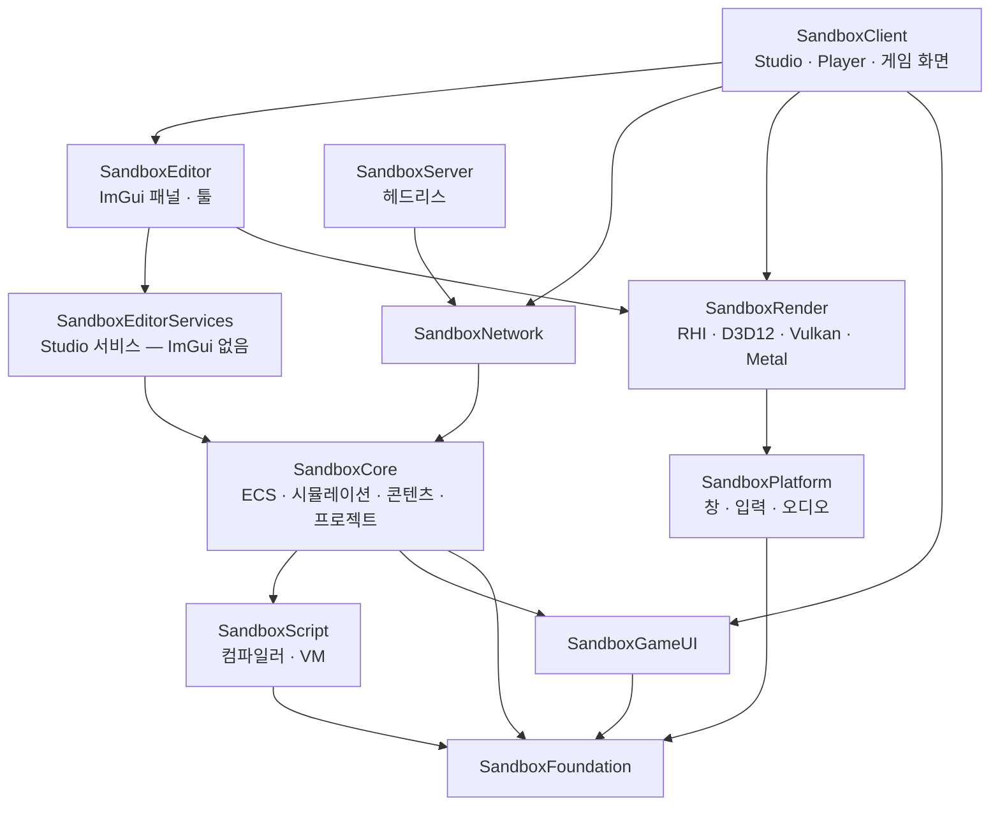
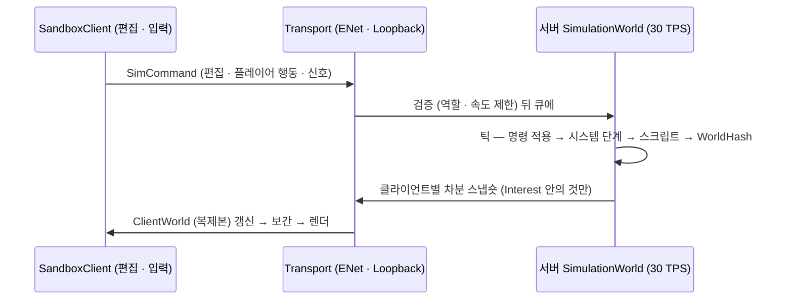
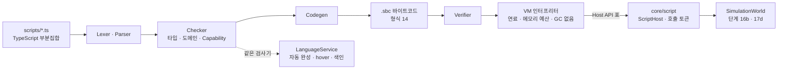
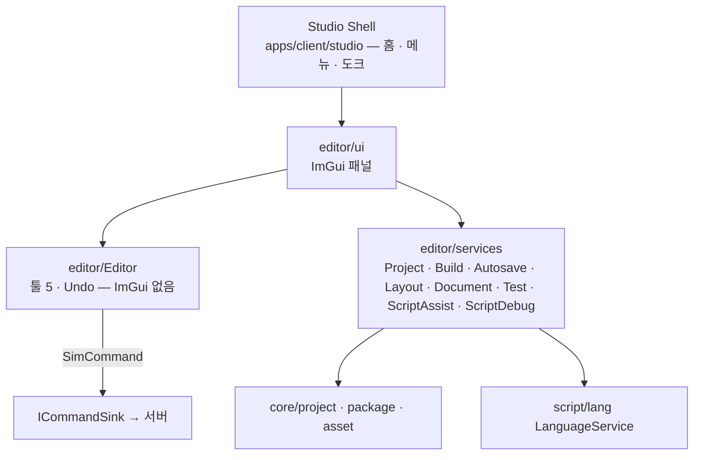

# 모듈 안내 — 역할 · 상태 · 어디를 읽나

> **보는 문서.** 모듈마다 "무엇을 하나 · 지금 어디까지 됐나 · 제약은 무엇인가 · 어느 문서가 규범인가" 를 한 화면으로 적는다.
> 설계의 정본은 각 절의 "관련 문서" 에 있는 규범 문서다 — 여기는 입구이고, 그 내용을 다시 쓰지 않는다.
> 그림은 CMake 의 `target_link_libraries` 와 [01-ARCHITECTURE](../01-ARCHITECTURE.md) 를 대조해 그렸다 (2026-11-12).

| 항목 | 내용 |
|---|---|
| 문서 목적 | 모듈별 입구 — 역할 · 현재 상태 · 제약 · 관련 문서 |
| 문서 상태 | 확정 |
| 마지막 검증일 | 2026-11-12 (master `1cce764` 위) |

## 목차

- [전체 구조](#전체-구조)
- [ECS](#ecs) · [시뮬레이션 · 결정론](#시뮬레이션--결정론) · [월드 · 세이브](#월드--세이브) · [콘텐츠 · 게임 규칙](#콘텐츠--게임-규칙)
- [SandboxScript](#sandboxscript) · [네트워크](#네트워크) · [렌더링](#렌더링) · [플랫폼](#플랫폼)
- [게임 UI 런타임](#게임-ui-런타임) · [에디터 · Studio](#에디터--studio) · [프로젝트 · 패키지](#프로젝트--패키지)

## 전체 구조

### 타깃 의존 (화살표 = "링크한다")

경계 규칙 (서버는 Platform · Render · Editor 를 링크하지 않는다, Script · GameUI 는 Foundation 만 안다 등) 은
[AGENTS](../../AGENTS.md) 4장 · [01](../01-ARCHITECTURE.md) 2장이 정하고 `tools/check_includes.py` · CMake 가 검사한다.

### 실행 중 데이터 흐름

싱글플레이도 같은 프로세스 안의 서버와 Loopback 으로 같은 길을 탄다 (01 A2). 월드를 바꾸는 길은 서버가 적용하는 SimCommand 하나뿐이다 (A1).

## ECS

| 항목 | 내용 |
|---|---|
| 개요 | 자체 Sparse Set ECS — EntityId · Registry · View · EntityCommandBuffer · 리플렉션 · 변경 추적 |
| 현재 상태 | ✅ 완료. 스크립트 `defineComponent` 의 동적 컴포넌트 풀 포함 (v0.3) |
| 구성 | `core/ecs` (저장 · 카탈로그), `core/components` (엔진 컴포넌트 — transform · velocity · collider · life · ai · game) |
| 제약 | 컴포넌트는 명시 등록 (ADR-0011). 컴포넌트에 GPU · OS 핸들 · 포인터를 넣지 않는다. 계층 (부모-자식) 이 없는 평평한 구조 |
| 향후 | 단계 안 병렬은 측정 뒤 결정 (RT-09-3, v0.22 Review) |
| 관련 문서 | [02-ECS](../02-ECS.md) · ADR-0002 · 시험 `unit_ecs` · `property_ecs` |

## 시뮬레이션 · 결정론

| 항목 | 내용 |
|---|---|
| 개요 | 30 TPS 고정 틱 파이프라인 — 명령 적용 → 이동 · 충돌 · 행동 · 규칙 → 스크립트 (16b) → 게임 규칙 (17b) · 트리거 (17c) · 스크립트 콜백 (17d) → 해시 |
| 현재 상태 | ✅ 완료. 물리는 🟡 (원 분리 충돌 · 질의만). Stage 12 ~ 14 (Combat · Resource · Production) · HPA* 는 `[계획]` |
| 구성 | `core/simulation` (SimulationWorld · SystemScheduler) · `core/systems` · `core/command` (SimCommand) · `core/replay` (Replay · WorldHash) · `core/path` |
| 제약 | [04-DETERMINISM](../04-DETERMINISM.md) 이 다른 모든 문서보다 우선한다 — 입력 장치 · 벽시계 · 스레드 완료 순서를 보지 않는다. 동작을 바꾸면 `kSimVersion` 을 올리고 골든을 갱신한다 (지금 4). 골든 해시는 툴체인마다 따로다 (ADR-0012) |
| 향후 | 물리 단계 · PhysicsCommand · 충돌 이벤트 ([v0.11](../roadmap/versions/v0.11.md)), 교차 툴체인 결정론 (RH-22-7) |
| 관련 문서 | [03-SIMULATION](../03-SIMULATION.md) · [04](../04-DETERMINISM.md) · [22-RUNTIME-V2](../22-RUNTIME-V2.md) · 시험 `det_*` |

## 월드 · 세이브

| 항목 | 내용 |
|---|---|
| 개요 | 청크 월드 · 지형 · 공간 색인, 세이브 폴더 (world.json · entities.jsonl · chunks) · 리플레이 · 마이그레이션 |
| 현재 상태 | ✅ 완료. 게임 버전 사이 세이브 마이그레이션 계약 포함 (v0.6 NG-04) |
| 구성 | `core/world` · `core/persist` · `core/serialization` · `core/replay` |
| 제약 | 월드 = 세이브 폴더 (ADR-0040). 스트리밍 · TagMask 는 `[계획]` |
| 향후 | 타일맵 (NG-15, v0.12) · 에셋 스트리밍 (RT-08-4, v0.18) |
| 관련 문서 | [05-WORLD](../05-WORLD.md) · [09-SERIALIZATION](../09-SERIALIZATION.md) · 시험 `det_world_save_load` · `unit_persist` |

## 콘텐츠 · 게임 규칙

| 항목 | 내용 |
|---|---|
| 개요 | 콘텐츠 팩 (JSON) — Prefab · Tag · Rule · Behavior 그래프 · GameMode · PlayerAction · Visual Trigger · scripts/, 검증기와 contentHash |
| 현재 상태 | ✅ 완료 |
| 구성 | `core/content` (로더 · 검증) · `core/trigger` · `core/game` (GameRules) · `content/` (기본 팩) · `samples/` |
| 제약 | 데이터 모양을 바꾸면 [11](../11-CONTENT-SCHEMA.md) 을 같은 커밋에서 고친다. Studio 편집은 오버레이 적용과 팩 파일 저장을 구분한다 (ADR-0131) |
| 향후 | 데이터 폼 · 트리거 그래프 캔버스 (ST-06-10, v0.12) |
| 관련 문서 | [11-CONTENT-SCHEMA](../11-CONTENT-SCHEMA.md) · 03 · 시험 `content_eco_validate` · `sample_playthrough` |

## SandboxScript

| 항목 | 내용 |
|---|---|
| 개요 | 게임 스크립트 언어 — 자체 컴파일러 · 검증하는 바이트코드 · VM. `defineComponent` (세이브 · 복제 · Inspector) · `defineSystem` (onTick · onStart · onEvent · onStop · onMigrate) · client `onUpdate` |
| 현재 상태 | 언어 · VM · 표준 라이브러리 ✅. Runtime 콜백은 🟡 — 호출 토큰 ✅ (v0.10 RT-06-1), 타이머 · client 수명주기 · onAction (v0.10) · onPrePhysics · onRender (v0.11) 는 미착수 |
| 구성 | `script/lang` (렉서 · 파서 · 검사기 · 코드 생성 · 언어 서비스) · `script/vm` · `script/api` (Host 표 · 콜백 표) · `script/sdk` (d.ts 생성) · `core/script` (Host 바인딩 · 어댑터) |
| 제약 | `script/` 는 Foundation 만 안다 (ECS 를 모른다 — ADR-0056). Host API 를 빼거나 바꾸면 `kHostApiVersion`, 더하면 지문만 바뀐다. JIT 없음 |
| 향후 | [v0.10](../roadmap/versions/v0.10.md) · [v0.11](../roadmap/versions/v0.11.md), `sbx lsp` (ST-07-3, v0.21) |
| 관련 문서 | [19-SANDBOXSCRIPT](../19-SANDBOXSCRIPT.md) · [22](../22-RUNTIME-V2.md) · [27-SCRIPT-IDE](../27-SCRIPT-IDE.md) · [안내서](../tutorials/stdlib.md) · 시험 `unit_script` |

## 네트워크

| 항목 | 내용 |
|---|---|
| 개요 | 서버 권위 — Transport (ENet · Loopback · Simulated) · 핸드셰이크 · 명령 검증 · 클라이언트별 차분 스냅숏 · Interest · 역할 |
| 현재 상태 | ✅ 완료 (LAN · 신뢰 환경 한정). 프로토콜 버전 18 |
| 구성 | `network/transport` · `network/protocol` · ServerHost · LocalServerHost · ClientSession |
| 제약 | **암호화 · 인증이 없다** — 인터넷에 열지 않는다 (위험 R6). 메시지를 바꾸면 `kProtocolVersion` 을 올린다 (불일치는 핸드셰이크에서 거절) |
| 향후 | 보안 전송 · 방 ([v0.16](../roadmap/versions/v0.16.md)), 예측 ([v0.17](../roadmap/versions/v0.17.md)), NetworkModule ([v0.18](../roadmap/versions/v0.18.md)) |
| 관련 문서 | [08-NETWORK](../08-NETWORK.md) · [24-SECURITY-GATES](../24-SECURITY-GATES.md) · 시험 `net_convergence` · `unit_network` |

## 렌더링

| 항목 | 내용 |
|---|---|
| 개요 | 얇은 자체 RHI 위의 D3D12 (Windows) · Vulkan (Linux · Windows) · Metal (macOS). HLSL → DXIL / SPIR-V / MSL. 스프라이트 아틀라스 · 지형 · ImGui |
| 현재 상태 | 자동 시험 ✅ (WARP · lavapipe · Metal 기준 이미지). 실기는 ⚠️ — Windows 일부만 확인, Linux · macOS 는 창 · GPU 로 돌려 보지 않았다 |
| 구성 | `render/rhi` · 백엔드 셋 · `render/asset` (AssetManager) · `shaders/` · ECS → RenderWorld 변환은 `apps/client/presentation` |
| 제약 | SandboxRender 는 ECS 를 모른다. 에셋 해제 · Hot Reload 없음. 2D 만 |
| 향후 | onRender Draw API (RT-06-9, v0.11) · 스트리밍 (RT-08-4) · 실기 매트릭스 (RH-23-7) |
| 관련 문서 | [06-RENDERING](../06-RENDERING.md) · [26-ASSET-PIPELINE](../26-ASSET-PIPELINE.md) · 시험 `render_tests_*` |

## 플랫폼

| 항목 | 내용 |
|---|---|
| 개요 | OS 계층 — 창 · 입력 이벤트 · ActionMap · 게임패드 · 클립보드 · IME · 프로세스 · 충돌 처리 |
| 현재 상태 | Windows ✅, Linux X11 · Wayland 구현 (실기 ⚠️), macOS Cocoa 구현 (CI 빌드 · 시험만 — 실기 ⚠️). **오디오는 Null 백엔드뿐 (⬜)** |
| 구성 | `platform/windows` · `linux` · `macos` · `common` · `audio` · `crash` · `process` · `stub` |
| 제약 | `foundation` · `script` · `core` · `network` 는 OS · 그래픽 헤더를 include 하지 않는다 |
| 향후 | 오디오 출력 (NG-17, v0.11) · 입력 Context (RT-06-8, v0.10) · Hold · Combo (RT-06-13, v0.12) |
| 관련 문서 | [07-PLATFORM](../07-PLATFORM.md) · 시험 `unit_platform` · `platform_x11` · `platform_wayland` · `platform_cocoa` |

## 게임 UI 런타임

| 항목 | 내용 |
|---|---|
| 개요 | 게임이 띄우는 HUD · 메뉴 — 선언 문서 (JSON) → 검사 → 배치 → 그리기 목록, 바인딩 · 버튼 → 서버가 판정하는 신호, 입력 컨트롤, 문자열 표 · 폰트 대체 · 배율 |
| 현재 상태 | ✅ 완료 (0.7.0). 화면 확인은 🟡 (MANUAL-QA v0.7 줄 7 / 19) |
| 구성 | `ui/` (SandboxGameUI — 문서 · 배치 · 바인딩) · `apps/client/ui/GameUiImGui` (그리기 백엔드) |
| 제약 | `ui/` 는 Foundation 만 안다 (core · render · ImGui 를 모른다 — ADR-0079 · 0101). UI 는 표시뿐 — 서버가 UI 문서를 읽지 않는다 |
| 향후 | Game UI Designer (ST-06-4, v0.10) |
| 관련 문서 | [20-CREATOR-ALPHA](../20-CREATOR-ALPHA.md) 2 · 6장 · ADR-0101 ~ 0107 · 시험 `unit_ui` |

## 에디터 · Studio

| 항목 | 내용 |
|---|---|
| 개요 | 월드 편집 (서버에 보내는 명령) 과 그 위의 Studio (홈 · 빌드 · 자동 저장 · 테스트 세션 · 스크립트 편집기 · 디버거) |
| 현재 상태 | 월드 에디터 ✅. Studio 셸 · 서비스 (v0.8) 와 Script IDE (v0.9) 는 코드 · 자동 시험 ✅ · **창 QA 대기 🟡** |
| 구성 | `editor/` (툴 · Undo) · `editor/ui` (ImGui 패널) · `editor/services` (Studio 서비스) · `apps/client/studio` · `apps/client/player` |
| 제약 | `editor/services` 는 Foundation · Script · Core 만 안다 (ADR-0089 · 0108). 편집도 SimCommand 로만. 회전 · 크기 전용 툴 없음, Prefab 은 JSON 편집, 에셋 가져오기 화면 없음 |
| 향후 | Asset Browser · UI Designer ([v0.10](../roadmap/versions/v0.10.md)), Prefab 오버라이드 · 그룹 · 데이터 폼 ([v0.12](../roadmap/versions/v0.12.md)) |
| 관련 문서 | [10-EDITOR](../10-EDITOR.md) · [25](../25-STUDIO-ARCHITECTURE.md) · [29-STUDIO-UI](../29-STUDIO-UI.md) · [27](../27-SCRIPT-IDE.md) · [28](../28-CREATOR-UX-GATES.md) · 시험 `unit_editor` · `studio_*` |

## 프로젝트 · 패키지

| 항목 | 내용 |
|---|---|
| 개요 | 게임 프로젝트 (매니페스트 · 검사) · 게임 패키지 (.sbpkg) · 패키지 관리자 (의존 해석 · 잠금 · 설치) · 프로젝트 에셋 (.meta 안정 id) · 진단 · 충돌 보고 |
| 현재 상태 | ✅ 완료. 에셋 가져오기는 CLI 만 (🟡) |
| 구성 | `core/project` · `core/package` · `core/asset` · `tools/sbx` (new · check · build · test · install · asset · doctor · report) · `foundation/diag` · `platform/crash` |
| 제약 | 패키지 서명 · 압축 · 레지스트리 없음. Export Profile 은 Windows 만 검증 |
| 향후 | 레지스트리 · 서명 ([v0.14](../roadmap/versions/v0.14.md)) · 게시 · 설치 · 채널 ([v0.15](../roadmap/versions/v0.15.md)) |
| 관련 문서 | [18-PLATFORM](../18-PLATFORM.md) 5장 · [09](../09-SERIALIZATION.md) 9장 · [26](../26-ASSET-PIPELINE.md) · [15-BUILD](../15-BUILD.md) 7장 · 시험 `project_*` · `tech_alpha_e2e` |
