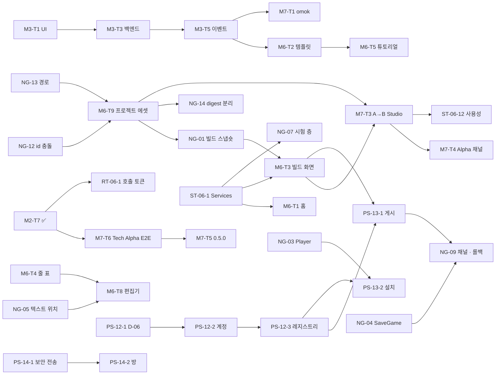

# 로드맵 (v0.5 ~ GA — 2026-11-03 재구성, ADR-0096)

> **로드맵의 정본.** 지금 · 다음 · 버전 표 · 의존 그래프 · 검사. 버전 체계는 [versioning](versioning.md), 태스크마다의 목표 · 상태 ·
> 선행 · 완료 기준은 [task-registry](task-registry.md), 버전별 목표는 [releases](releases.md), 출시 기준은 [release-gates](release-gates.md).
> 태스크 카드의 자세한 내용 (모듈 · API · 형식 · 시험) 은 그대로 [20](../20-CREATOR-ALPHA.md) 10장 · [23](../23-ROADMAP.md) · [22](../22-RUNTIME-V2.md) ·
> [25](../25-STUDIO-ARCHITECTURE.md) ~ [28](../28-CREATOR-UX-GATES.md) 에 있다 — 그 문서들의 "[계획 v0.x]" 는 [versioning 4장](versioning.md) 의
> 변환표로 읽는다. 재구성의 근거는 [2차 감사](../audit/SECOND-PASS-GAP-ANALYSIS.md).

---

## 1. 지금 · 다음

```text
제품      0.4.0 (v0.4 Package Manager). v0.5 는 Technical Alpha 로 범위를 줄였다 — M1 ✅ · M2 ✅ · M8 ✅
다음      트랙 A  M7-T6 Technical Alpha A → B (CLI 빌드 → 다른 폴더 · 빈 캐시 → 같은 해시) → M7-T5 0.5.0
          트랙 A  M3-T1 게임 UI (v0.7) — M7-T6 과 독립, 병렬
          트랙 B  NG-12 · NG-13 (에셋 id · 경로 정책) → M6-T9 프로젝트 에셋 (v0.6)
          트랙 C  없음 (v0.12 전에는 D-06 저장소 경계 결정만 — PS-12-1)
```

## 2. 트랙

| 트랙 | 무엇 | 첫 버전 | 다른 트랙을 기다리나 |
|------|------|---------|-----------------------|
| A Engine Runtime | 시뮬레이션 · 스크립트 · 네트워크 · 게임 UI 런타임 · 다국어 · 물리 · 예측 | v0.5 | 아니오 — UI 디자이너 (B) 는 A 의 UI 런타임 (M3) 을 기다린다 |
| B Creator Studio | 프로젝트 에셋 · Studio 셸 · 빌드 화면 · IDE · 콘텐츠 도구 · Player · 시험 층 | v0.6 | Closed Creator Alpha (v0.11) 만 A 의 M3 · RT-06-1 을 모은다 |
| C Platform Services | 계정 · 레지스트리 · 게시 · 방 · 호스팅 · 결제 · 팀 | v0.12 | B 의 빌드 화면 (게시) · Player (설치) |

## 3. 버전 표

| 버전 | 목표 (한 줄) | 성숙 단계 | 트랙 |
|------|--------------|-----------|------|
| v0.5 | CLI 로 만든 게임이 다른 폴더 · 빈 캐시에서 같은 결과 | Technical Alpha | A |
| v0.6 | 프로젝트 에셋 · 패키지 무결성 · 세이브 마이그레이션 계약 | | B · A |
| v0.7 | 게임 UI 런타임 · 다국어 기반 | | A |
| v0.8 | Studio 기반 — 홈 · 빌드 화면 · 복구 · 테스트 실행 · Player | | B |
| v0.9 | 스크립트 IDE | | B · A |
| v0.10 | 콘텐츠 도구 · Runtime v2 실행 | | B · A |
| v0.11 | 외부 제작자가 Studio 만으로 만들고 친구가 실행 | Closed Creator Alpha | B |
| v0.12 | 계정 · 레지스트리 · 서명 | | C |
| v0.13 | 게시 · 설치 · 채널 · 롤백 | Public Creator Alpha | C · B |
| v0.14 | 인증된 멀티플레이 · 방 | | C |
| v0.15 | 예측 | Closed Beta | A |
| v0.16 | 호스팅 · NetworkModule · 스트리밍 | | C · A |
| v0.17 | 결제 (테스트 모드) · 마켓 | | C |
| v0.18 | 정산 · 분석 · 등급전 | | C |
| v0.19 | 팀 · 협업 · 플러그인 API | Public Beta | C · B |
| v0.20 | 안정화 · 성능 회귀 CI · 보안 감사 준비 · 1.0 전환 정책 | | 전부 |
| v0.21 ~ | GA 후보 판정 — 통과하면 v1.0.0 | (GA) | 전부 |

## 4. 의존 그래프 (P0 · 주요 P1)



```text
임계 경로 (Closed Creator Alpha 까지)
  NG-12 · NG-13 → M6-T9 → NG-01 → M6-T3 (+ ST-06-1) → M7-T3 → ST-06-12 · M7-T4        (트랙 B)
  M3-T1 → M3-T3 → M3-T5 → M6-T2 · M7-T1                                                  (트랙 A, 병렬)
  NG-05 · M6-T4 → M6-T8                                                                   (트랙 B, 병렬)
병렬 가능  M7-T6 (A) ∥ NG-12 · NG-13 (B) ∥ M3-T1 (A) ∥ NG-04 (A) ∥ ST-06-1 (B) — 서로 파일이 겹치지 않는다
```

## 5. 일관성 검사 (tools/check_docs.py — CTest docs_consistency)

```text
L  docs/ · README · AGENTS 의 상대 링크가 실제 파일
A  "ADR-NNNN" 마다 docs/adr/NNNN-*.md
T  현행 계획 문서 (18 · 20 · 22 ~ 28 · roadmap/ · audit 의 ALPHA-READINESS · SECOND-PASS) 의 태스크 ID 가 등록부 (또는 옛 번호 표) 에 있다
   — "v0.3 M4-T2" 처럼 옛 버전이 바로 앞에 붙은 ID 는 v0.1 ~ v0.4 이력이라 건너뛴다
V  등록부의 목표 버전이 versioning 3장 버전 목록에 있다
S  등록부에서 Done 인 태스크가 계획 문서에서 같은 줄에 "[계획" 으로 남아 있지 않다 (✅ 가 같이 있으면 괜찮다)
예외  KNOWN (이유 필수) — 지금 하나: ADR-0085 의 오타 링크 (기존 ADR 은 고치지 않는다)
```

새 태스크는 등록부에 먼저 행을 더하고, 새 버전은 versioning 3장 목록 끝에 더한다. 태스크 ID 는 다시 쓰지 않는다 (등록부 2장).
