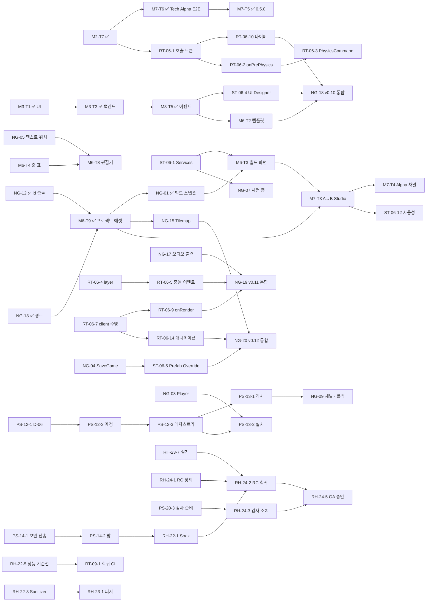

# 로드맵 (v0.5 ~ v1.0.0 — 2026-11-03 재구성, ADR-0096 · ADR-0099 · ADR-0100)

> **로드맵의 정본.** 지금 · 다음 · 버전 표 · 의존 그래프 · 검사. 버전 체계는 [versioning](versioning.md), 태스크마다의 목표 · 상태 ·
> 선행 · 완료 기준은 [task-registry](task-registry.md), 버전별 목표 · 태스크 배정 · 완료 기준은 [releases](releases.md), 출시 기준은
> [release-gates](release-gates.md), 안정화 · RC · GA 검증 방법은 [stabilization](stabilization.md).
> 태스크 카드의 자세한 내용 (모듈 · API · 형식 · 시험) 은 그대로 [20](../20-CREATOR-ALPHA.md) 10장 · [23](../23-ROADMAP.md) · [22](../22-RUNTIME-V2.md) ·
> [25](../25-STUDIO-ARCHITECTURE.md) ~ [28](../28-CREATOR-UX-GATES.md) 에 있다 — 그 문서들의 "[계획 v0.x]" 는 [versioning 4장](versioning.md) 의
> 변환표로 읽는다. 재구성의 근거는 [2차 감사](../audit/SECOND-PASS-GAP-ANALYSIS.md) · [일관성 점검](../audit/ROADMAP-CONSISTENCY.md).

---

## 1. 지금 · 다음

```text
제품      0.6.0 (v0.6 에셋 · 패키지 · SaveGame — [릴리스 노트](../releases/v0.6.0.md)). 지금 버전 v0.7
다음      트랙 A  M3-T6 게임 UI 스타일 · 테마 · 배율 (v0.7) — M3-T1 ~ T5 ✅ 문서 · 배치 · 그리기 · 입력 · 바인딩 · 이벤트
          트랙 B  ST-06-1 Editor Services (v0.8) — v0.6 ✅ 0.6.0
          트랙 C  없음 (v0.14 전에는 D-06 저장소 경계 결정만 — PS-12-1)
```

## 2. 트랙

| 트랙 | 무엇 | 첫 버전 | 다른 트랙을 기다리나 |
|------|------|---------|-----------------------|
| A Engine Runtime | 시뮬레이션 · 스크립트 · 네트워크 · 게임 UI 런타임 · 다국어 · 물리 · 예측 · 안정화 | v0.5 | 아니오 — UI 디자이너 (B) 는 A 의 UI 런타임 (M3) 을 기다린다 |
| B Creator Studio | 프로젝트 에셋 · Studio 셸 · 빌드 화면 · IDE · 콘텐츠 도구 · Player · 시험 층 | v0.6 | Closed Creator Alpha (v0.13) 만 A 의 M3 · RT-06-* 를 모은다 |
| C Platform Services | 계정 · 레지스트리 · 게시 · 방 · 호스팅 · 결제 · 팀 · 운영 | v0.14 | B 의 빌드 화면 (게시) · Player (설치) |

## 3. 버전 표

| 버전 | 목표 (한 줄) | 성숙 단계 (기준으로 확정) | 트랙 |
|------|--------------|---------------------------|------|
| v0.5 | CLI 로 만든 게임이 다른 폴더 · 빈 캐시에서 같은 결과 | Technical Alpha | A |
| v0.6 | 에셋 · 패키지 · SaveGame 기반 | | B · A |
| v0.7 | 게임 UI Runtime · 다국어 기반 | | A |
| v0.8 | Studio 기본 환경 — 홈 · 빌드 화면 · 복구 · 테스트 실행 · Player | | B |
| v0.9 | Script IDE | | B · A |
| v0.10 | Creator Foundation — 에셋 · UI 디자이너 · 템플릿 · Capability 실행 · client 수명주기 · 타이머 | | B · A |
| v0.11 | Gameplay Runtime — 물리 단계 · 충돌 · 트리거 · onRender · 오디오 출력 | | A |
| v0.12 | Advanced Creator Tools — Prefab 오버라이드 · 타일맵 · 애니메이션 · 고급 입력 · 믹서 | | B · A |
| v0.13 | 외부 제작자가 Studio 만으로 만들고 친구가 실행 | Closed Creator Alpha | B |
| v0.14 | 계정 · 레지스트리 · 서명 | | C |
| v0.15 | 게시 · 설치 · 채널 · 롤백 | Public Creator Alpha | C · B |
| v0.16 | 멀티플레이 · 방 | | C |
| v0.17 | 예측 | Closed Beta | A |
| v0.18 | 호스팅 · NetworkModule · 스트리밍 | | C · A |
| v0.19 | 결제 (테스트 모드) · 에셋 마켓 | | C |
| v0.20 | 정산 · 분석 · 등급전 | | C |
| v0.21 | 팀 · 협업 · 플러그인 API | Public Beta 후보 | C · B |
| v0.22 | Reliability & Performance — Soak · Sanitizer · 성능 기준선 · 회귀 CI · 교차 툴체인 결정론 | | A · B · C |
| v0.23 | Security & Release Hardening — 퍼저 · 탈출 · 네트워크 · 공급망 · 서명 업데이트 · 복구 · 실기 | | A · C |
| v0.24 | Release Candidate — 동결 · 전체 재검증 · 외부 감사 조치 | Release Candidate | 전부 |
| v0.25+ | (필요할 때만) RC 를 다시 냄 | Release Candidate | 전부 |
| v1.0 | GA 차단 조건 0 · 승인 기록 → 검증한 RC 빌드에 v1.0.0 | General Availability | 전부 |

## 4. 의존 그래프 (P0 · 주요 P1)



```text
임계 경로 (Closed Creator Alpha 까지)
  NG-12 · NG-13 → M6-T9 → NG-01 → M6-T3 (+ ST-06-1) → M7-T3 → ST-06-12 · M7-T4                       (트랙 B)
  M3-T1 → M3-T3 → M3-T5 → ST-06-4 · M6-T2 → NG-18 (v0.10)                                            (트랙 A → B)
  RT-06-1 → RT-06-2 · RT-06-7 → RT-06-5 · RT-06-9 → NG-19 (v0.11) → NG-20 (v0.12)                     (트랙 A)
  NG-05 · M6-T4 → M6-T8                                                                               (트랙 B, 병렬)
임계 경로 (GA 까지)
  PS-14-2 → RH-22-1 Soak → RH-24-2 RC 회귀 → RH-24-5 GA 승인, 그리고 PS-20-3 → RH-24-3 · RH-23-7 실기 → RH-24-2
병렬 가능  M3-T6 (A) ∥ ST-06-1 (B), 안정화의 RH-22-3 · RH-22-5 · RH-23-4 는 서비스 없이 일찍 시작할 수 있다
          (목표 버전보다 일찍 끝내도 된다 — 목표는 "늦어도")
```

## 5. 일관성 검사 (tools/check_docs.py — CTest docs_consistency · docs_consistency_selftest)

```text
L  docs/ · README · AGENTS 의 상대 링크가 실제 파일
A  "ADR-NNNN" 마다 docs/adr/NNNN-*.md
T  현행 계획 문서 (18 · 20 · 22 ~ 28 · roadmap/ · audit 의 ALPHA-READINESS · SECOND-PASS) 의 태스크 ID 가 등록부 (또는 옛 번호 표) 에 있다
   — "v0.3 M4-T2" 처럼 옛 버전이 바로 앞에 붙은 ID 는 v0.1 ~ v0.4 이력이라 건너뛴다
V  등록부의 목표 버전이 versioning 3장 버전 목록에 있다
S  등록부에서 Done 인 태스크가 계획 문서에서 같은 줄에 "[계획" 으로 남아 있지 않다 (✅ 가 같이 있으면 괜찮다)
D  선행 태스크의 목표 버전이 그 태스크보다 뒤가 아니다 (정수 비교 — v0.10 > v0.9, v1.x 는 마지막)
R  끝나지 않은 태스크는 releases 의 한 버전 절 "태스크" 줄에만 있고, 그 버전 = 등록부 목표 (태스크마다 버전 하나)
예외  KNOWN (이유 필수) — ADR-0085 의 오타 링크 · 18 7장의 v0.2 이력 ID
자체 시험  tests/docs/fixtures (일부러 틀린 작은 저장소) 에서 정확히 N 건을 찾아야 통과 (--expect)
```

새 태스크는 등록부에 먼저 행을 더하고 releases 의 그 버전 "태스크" 줄에 넣는다. 새 버전은 versioning 3장 목록 끝에 더한다.
태스크 ID 는 다시 쓰지 않는다 (등록부 2장).
